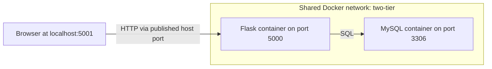

# Flask + MySQL on Docker

A three-part Docker lab by Suman Yadav. Part 1 documents how I ran Flask and MySQL as separate containers, exposed the Flask HTTP endpoint, and verified that the application stored messages in MySQL.

## Part 1 — Containers and networking

| Check | Observed result |
| --- | --- |
| Container status | Flask and MySQL were running. Docker reported Flask as healthy. |
| Network membership | Both containers were attached to `two-tier` and the default `bridge` network. |
| Port publishing | Docker mapped host port `5001` to Flask port `5000`. MySQL had no published host port. |
| HTTP | `curl` returned HTTP 200 from the Flask endpoint. |
| Database | A SQL query returned records the application stored. |

See the [Part 1 networking and verification notes](docs/01-docker-networking.md).

## Milestones

| Part | Scope | Status |
| --- | --- | --- |
| 1 | Containerization, port publishing, and networking | Completed |
| 2 | Named MySQL volume and a persistence test across container recreation | Planned |
| 3 | Reproducible multi-container startup using Docker Compose | Planned |

## Attribution

The original Flask application is by [Shubham Londhe](https://github.com/LondheShubham153/two-tier-flask-app). I used upstream commit `6c2ec24` while following his [Docker tutorial](https://www.youtube.com/watch?v=9bSbNNH4Nqw). This repository documents my lab setup and verification. Refer to the upstream repository for the application source.
